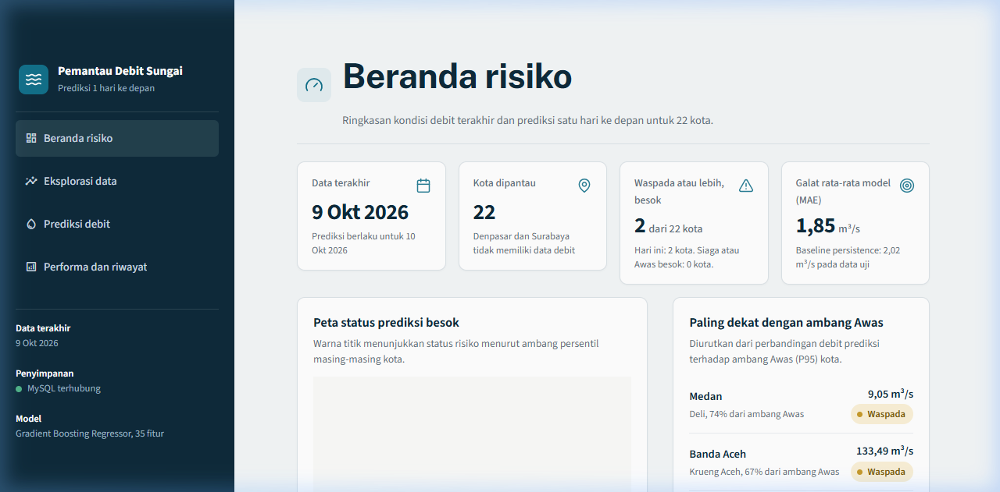
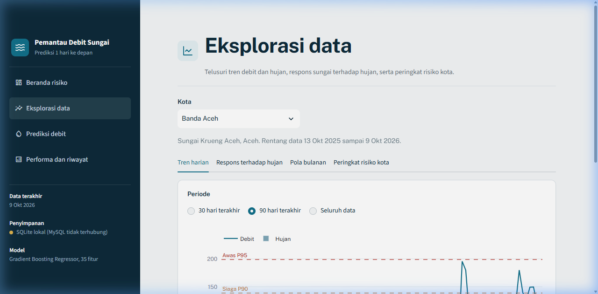
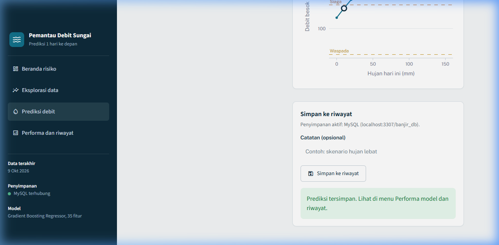
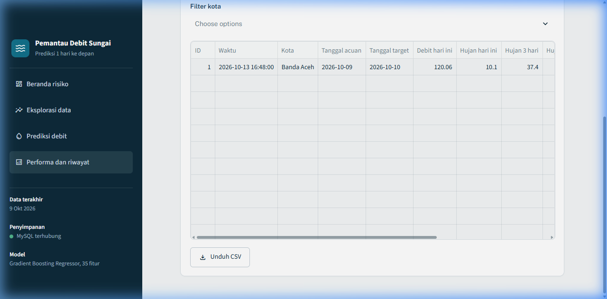

# Pemantau Debit Sungai

Dashboard prediksi debit sungai 1 hari ke depan dan risiko banjir untuk 22 kota di Indonesia, dibangun dengan Streamlit dan model Gradient Boosting.

---

## Gambaran proyek

### Pertanyaan bisnis yang dijawab

1. Kota mana yang paling berisiko banjir berdasarkan rasio debit puncak terhadap debit rata-rata?
   Jawab: Banda Aceh dengan rasio puncak 54,6x dan lonjakan 25,4% hari.
2. Bulan apa yang paling berisiko banjir?
   Jawab: Bulan November (pola curah hujan musiman).
3. Berapa lama jeda respons (lag) dari curah hujan ke debit sungai?
   Jawab: Rata-rata sekitar 1,8 hari.
4. Seberapa kuat hubungan antara curah hujan dan debit sungai?
   Jawab: Korelasi Spearman hujan 3 hari terhadap debit sekitar 0,65.
5. Seberapa baik model memprediksi debit besok dibanding baseline?
   Jawab: Model GBR mengungguli baseline persistence di semua metrik utama.

### Data

- 22 kota di Indonesia (Denpasar dan Surabaya dikeluarkan karena tidak ada data debit)
- Rentang data: 12 Oktober 2025 sampai 9 Oktober 2026 (sekitar 1 tahun, 7.970 baris)
- Sumber: data simulasi curah hujan harian dan debit sungai

### Model

Algoritma: Gradient Boosting Regressor  
Parameter: n_estimators=200, learning_rate=0.03, max_depth=3, subsample=0.8, min_samples_leaf=20, random_state=42  
Target latih: dlog = log1p(debit_besok) - log1p(debit_hari_ini)  
Konversi balik: debit_besok = max(expm1(log1p(debit_hari_ini) + dlog), 0)

### Hasil uji (split waktu 80/20, potong 2026-07-30)

| Metrik        | Model GBR | Baseline persistence |
|---------------|-----------|---------------------|
| MAE           | 1,8519    | 2,0204              |
| RMSE          | 7,2197    | 7,8920              |
| R2            | 0,9244    | 0,9096              |
| Recall Siaga  | 0,47      | 0,41                |

Baseline persistence: debit besok = debit hari ini.

---

## Tangkapan layar









---

## Struktur repo

```
prediksi-debit-sungai/
├── README.md
├── CATATAN_PENGERJAAN.txt
├── requirements.txt
├── .gitignore
├── app.py
├── .streamlit/
│   ├── config.toml
│   └── secrets.toml.example
├── artifacts_banjir/
│   ├── model_gbr_debit.joblib
│   ├── model_meta.json
│   ├── riwayat_harian.csv
│   └── ringkasan_eda.csv
├── database/
│   ├── schema_banjir_db.sql
│   ├── muat_data_mysql.py
│   └── tes_koneksi_mysql.py
├── notebook/
│   ├── proyek_prediksi_debit_sungai.ipynb
│   └── proyek_prediksi_debit_sungai.py
├── data_mentah/
│   ├── locations.csv
│   ├── river_discharge.csv
│   └── rainfall_daily.csv
└── docs/
    └── gambar/
```

---

## Cara menjalankan

### Persyaratan

- Python 3.10 sampai 3.13
- Opsional: MySQL 8.0 di localhost (tanpa MySQL, aplikasi otomatis memakai SQLite)

### Langkah

```bash
# 1. Clone repo
git clone https://github.com/dirga58/prediksi-debit-sungai.git
cd prediksi-debit-sungai

# 2. Buat virtual environment
python -m venv .venv

# Windows
.venv\Scripts\activate

# Mac/Linux
source .venv/bin/activate

# 3. Pasang pustaka
pip install -r requirements.txt

# 4. Jalankan dashboard
streamlit run app.py
```

Buka browser di `http://localhost:8501`.

---

## Menyambung MySQL localhost

1. Pastikan MySQL berjalan (XAMPP: klik Start pada modul MySQL; atau service MySQL80).
2. Jalankan skema database:
   ```bash
   mysql -u root -p < database/schema_banjir_db.sql
   ```
3. Salin file contoh kredensial:
   ```bash
   copy .streamlit\secrets.toml.example .streamlit\secrets.toml
   ```
4. Edit `.streamlit/secrets.toml` dan isi password MySQL Anda (jangan commit file ini).
5. Uji koneksi:
   ```bash
   python database/tes_koneksi_mysql.py
   ```
   Hasil yang benar: "Koneksi berhasil" dan daftar 4 tabel.
6. Muat data historis:
   ```bash
   python database/muat_data_mysql.py --host localhost --user root --password "kata_sandi_anda"
   ```
7. Jalankan ulang `streamlit run app.py`. Sidebar akan menampilkan "MySQL terhubung".

---

## Keterbatasan

- Data hanya sekitar 1 tahun (12 Oktober 2025 sampai 9 Oktober 2026). Pola musim panjang belum tercakup.
- Data uji (20% terakhir, Juli-Oktober 2026) didominasi musim kering, sehingga kejadian banjir besar tidak terwakili.
- Recall Siaga 0,47 dihitung dari hanya 17 kejadian di data uji. Sampel terlalu kecil untuk kesimpulan statistik kuat.
- Ambang risiko (Waspada, Siaga, Awas) berasal dari persentil data latih per kota, bukan ambang resmi.
- Selisih model terhadap baseline cukup tipis: MAE 1,85 vs 2,02, artinya debit hari ini masih menjadi prediktor kuat.
- Prediksi hanya untuk 1 hari ke depan, bukan prakiraan berantai multi-hari.

---

## Catatan

Proyek ini dibuat untuk keperluan akademik (mata kuliah Data Science dan Machine Learning). Bukan sistem peringatan dini resmi dan tidak boleh digunakan sebagai satu-satunya dasar keputusan dalam situasi darurat.

---

## Penulis

Dirga  
Email: dirgad58@gmail.com
